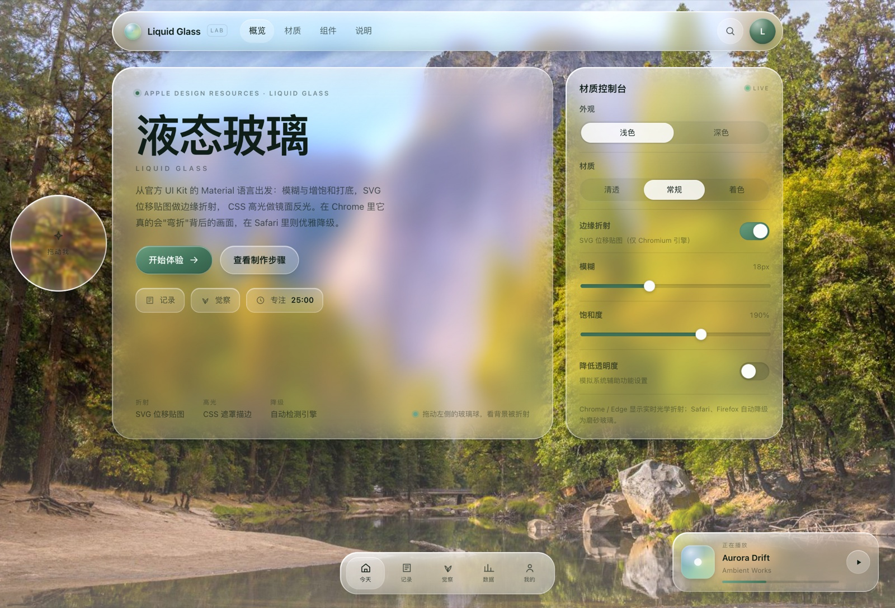

# Liquid Glass

**An independent, from-scratch recreation of Apple's Liquid Glass material for the web — shipped as CSS, a tiny JS runtime, a complete lab, and a reusable agent skill.**

No dependencies. No build step. Chromium gets real edge refraction; everything else gets a quiet frosted fallback.



[**Live demo**](https://yichen08092025.github.io/liquid-glass/) · [Dark mode](examples/lab/screenshots/dark-hero.jpg) · [Sections](examples/lab/screenshots/sections-light.jpg) · [Mobile](examples/lab/screenshots/mobile-light.jpg)

## 中文简介

这是把 Apple「液态玻璃」搬到 Web 的一套可复用实现：CSS 负责磨砂材质与镜面描边，SVG 位移贴图负责
Chromium 下的边缘折射；Safari / Firefox 自动降级为磨砂玻璃。仓库同时是一个 agent skill——
根目录的 `SKILL.md` 可以直接被支持技能系统的编码 agent 读取，用来制作或改造液态玻璃界面。

## What's inside

- **Two tiers, one material**
  - *Tier 1 — frosted glass*: `backdrop-filter` blur + saturation + brightness, a gradient specular rim,
    inner bevel shadows and a soft drop shadow. Works in every modern browser.
  - *Tier 2 — optical refraction*: a per-element SVG `feDisplacementMap` applied through
    `backdrop-filter: url(#filter)` so the glass edge actually bends the background. Chromium only,
    silently skipped elsewhere.
- **Material variants**: `regular`, `clear`, `tinted`, with light and dark tokens.
- **Primitives**: toolbar, dock / tab bar, buttons, segmented control, switch, field, chips, menu.
- **Accessibility built in**: `prefers-reduced-transparency`, `prefers-contrast`,
  `prefers-reduced-motion`, and a `.lg-reduced-transparency` preview class.
- **A worked lab**: `examples/lab/` — hero, console, three materials, components, dock, popover,
  and a draggable glass lens over a photo.
- **An agent skill**: `SKILL.md` + `references/sources.md` with the workflow, rules, migration
  playbook, verification checklist, Apple facts and browser limitations.

## Quick start

```html
<link rel="stylesheet" href="assets/liquid-glass.css">
<script src="assets/liquid-glass.js"></script>

<div class="lg-glass" style="--lg-radius: 24px; padding: 18px">
  Frosted panel. Add <code>lg-refract</code> for the Chromium optical layer.
</div>
```

```html
<!-- the version with edge refraction -->
<div class="lg-glass lg-refract" data-lg-bezel="16" data-lg-disp="22">
  ...
</div>
```

Map the tokens to your design system rather than restyling from scratch:

```css
:root {
  --lg-ink: var(--text);
  --lg-accent: var(--accent);
  --lg-radius: 24px;
  --lg-blur: 18px;   /* 10–14 small chrome · 16–22 panels */
  --lg-sat: 190%;
  --lg-bright: 1.1;  /* ~1.0 in dark */
}
```

The JS runtime auto-initializes on load. For dynamically mounted content, call
`LiquidGlass.init(container)`; `LiquidGlass.setEnabled(false)` turns refraction off while keeping the
frosted tier.

## How the refraction works

Each `.lg-refract` element gets a generated rounded-rect lens map:

1. signed distance field of the rounded rect → depth from the edge;
2. a convex-squircle falloff converts depth to displacement magnitude;
3. the inward normal is encoded into the R/G channels;
4. an SVG filter with `feImage` (the map) → `feDisplacementMap` is installed, and
   `--lg-refraction: url(#…)` is applied to `backdrop-filter`.

One gotcha worth repeating: `feDisplacementMap` interprets a channel as `(C/255 − 0.5) × scale`, so the
maximum shift is **scale / 2**. The runtime compensates by setting `scale = 2 × desiredPixels`.
Maps are cached by geometry and rebuilt with a `ResizeObserver`.

## Browser support

| Engine | Frosted glass (tier 1) | Edge refraction (tier 2) |
| --- | --- | --- |
| Chrome / Edge / Arc / Brave (Chromium) | ✅ | ✅ |
| Safari / WebKit | ✅ | ❌ (falls back silently) |
| Firefox | ✅ | ❌ (falls back silently) |

WebKit cannot use SVG filters as `backdrop-filter` (bug 245510, still open; confirmed by Apple's
Simon Fraser). The CSS is written so the page remains complete without tier 2.

## The honest part: the Figma myth

A popular recipe says: open Apple's Figma UI kit → find the Material page → **Copy as code → CSS** →
paste into your coding agent. That does not work. Apple's kit uses Figma's native Glass effect, and
Figma does not export Glass to CSS or SVG (it doesn't even render it in Figma Sites); Dev Mode only
emits the non-glass layers. On top of that, the kit's layer data sits behind a Figma login, and Apple
publishes no blur or saturation values for the OS material — its only explicit glass number is a
**35% dark dimming layer** for `clear` glass over bright media.

So this repository hand-authors the material from Apple's HIG semantics, first-party reference images
and the community's established SVG technique. Sources are labeled in
[`references/sources.md`](references/sources.md). If someone tells you they exported liquid glass CSS
from Figma, ask for the file.

## Repo layout

```
SKILL.md                     agent-facing workflow, rules, migration playbook, checklist
assets/liquid-glass.css      tokens + material + rim/sheen + variants + primitives + a11y
assets/liquid-glass.js       displacement-map runtime (Chromium), tiny API
examples/lab/                complete self-contained demo + screenshots used above
references/sources.md        Apple HIG facts, web CSS, Figma limits, WebKit bug, credits
LICENSE                      MIT
```

## Use it as an agent skill

The repository root *is* the skill. Clone or symlink it into a skills directory that your agent reads:

```bash
git clone https://github.com/yichen08092025/liquid-glass.git ~/.agents/skills/liquid-glass
# or, e.g.
git clone https://github.com/yichen08092025/liquid-glass.git ~/.claude/skills/liquid-glass
```

`SKILL.md` contains the trigger description, the step-by-step workflow, material rules, component
recipes, conversion playbook, and a verification checklist. It is model-invoked: an agent can reach
for it on its own when a task asks for glass / liquid glass / translucent UI.

## Development

There is no build. Open the lab directly:

```bash
open examples/lab/index.html          # macOS
python3 -m http.server 8000           # or any static server
```

The lab is self-contained (`lab.css`, `lab.js`, `assets/bg.jpg`). Its screenshots are the visual target
for tuning; the reusable core is `assets/`.

## Credits

- Apple HIG: [Materials](https://developer.apple.com/design/human-interface-guidelines/materials),
  [Adopting Liquid Glass](https://developer.apple.com/documentation/technologyoverviews/adopting-liquid-glass).
- Technique: [kube.io — Liquid Glass in the Browser](https://kube.io/blog/liquid-glass-css-svg),
  [shuding/liquid-glass](https://github.com/shuding/liquid-glass) (MIT),
  [VII-Cae/hyalite](https://github.com/VII-Cae/hyalite--liquid-glass) (MIT).
- Background photo: [Unsplash](https://unsplash.com) via [Picsum](https://picsum.photos) (Unsplash License).
- The community reverse-engineering and browser tests that made the limitations clear are cited in
  `references/sources.md`.

## License

[MIT](LICENSE). “Apple”, “iOS”, “macOS”, “Liquid Glass” are trademarks of Apple Inc. This project is
an independent educational recreation and is not affiliated with or endorsed by Apple.
